

  

  <a href="https://t.me/dwertyfa"></a>
  <a href="https://dwertyfa288.github.io/dwertyfa/"></a>
  <a href="https://github.com/SpherePrime"></a>

  

  

  <a href="https://github.com/dwertyfa288/dwertyfa-astra-tg"></a>
  <a href="https://github.com/dwertyfa288/astra-interject"></a>

  

  

  <a href="https://github.com/SpherePrime/CLI"></a>

  <a href="https://github.com/SpherePrime/CLI/tree/main/desktop"></a>

  <a href="https://github.com/SpherePrime/PrimeAi"></a>
  <a href="https://github.com/SpherePrime/PrimeProxy"></a>

  

  <a href="https://dwertyfa288.github.io/dwertyfa/"></a>

  <a href="https://novaprestige.ru/"></a>
  <a href="https://roxyvpn.ru/"></a>

  <a href="https://hostel-ekaterinburg.ru/"></a>
  <a href="https://lotos-polevskoy.ru/"></a>

  <a href="https://fazedanek-hub.github.io/danekmontage/"></a>
  <a href="https://heyksusha.ru/intensive"></a>

  <a href="https://t.me/dwertyfa"></a>

